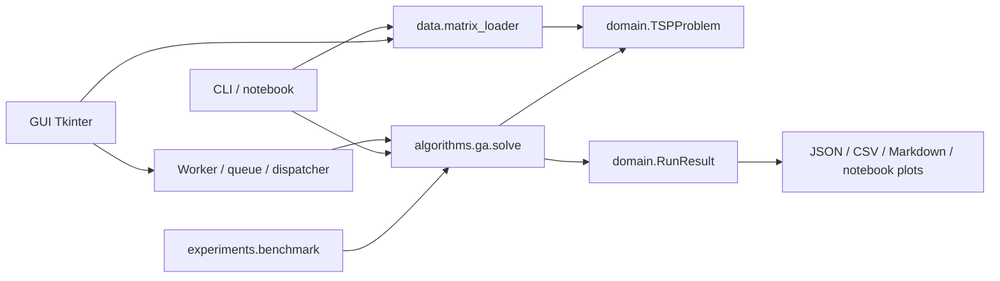

# Hợp đồng GA–EHO và kiến trúc bàn giao

Owner của `domain/*` và hợp đồng chung: **Trương Thành Đạt**. Các thành viên EHO đề xuất thay đổi có lý do, tác động và cách kiểm chứng trước khi sửa contract. EHO là solver độc lập, không import GA private internals. **EHOConfig chỉ là schema; chưa có EHO solver. GUI GA hiện có, xem [hướng dẫn](gui_guide.md).**

## Luồng dữ liệu



Domain chỉ dùng stdlib, không import loader/algorithm/GUI. Loader và GA phụ thuộc domain. CLI/notebook/benchmark gọi public API; không đọc hoặc sửa population. Benchmark/export là code chương trình thật, được giữ. Không có runtime dependency tới tests, report cũ, notebook gốc hoặc archive ngoài repository. Notebook không chỉnh sys.path; cần editable installation.

## Public API

| API | Input → output / trách nhiệm |
|---|---|
| data.matrix_loader.load_matrix | path → validated TSPProblem, SHA256 metadata |
| TSPProblem.route_length | route → full cycle cost, có validation |
| domain.objective.validate_route | sequence,n → None hoặc ValueError |
| domain.operators.random_permutation | n,random.Random → Route khóa0 |
| algorithms.ga.solve | problem,GAConfig,progress_callback/stop_requested → RunResult |
| domain.protocols.Solver[Config] | protocol dùng được với GAConfig/EHOConfig |
| experiments.benchmark.benchmark | config path → summary; xuất raw/structured results |

```python
solve(problem, config, *, progress_callback=None, stop_requested=None) -> RunResult
```

`Route=tuple[int,...]`, gồm mỗi city0..n−1 đúng một lần, city0 đầu tiên, không khép vòng. Objective tính đủ n cạnh kể cả cạnh cuối về0; chỉ presentation thêm0 cuối. Matrix n≥3, square, finite, nonnegative, diagonal0, symmetric: integers so chính xác, floats abs tolerance1e-9. Zero off-diagonal được phép. Không có ATSP.

## Dataclasses giữ nguyên

| Model | Fields / ngữ nghĩa |
|---|---|
| TSPProblem | name,distance_matrix,dimension(property),source,coordinates,known_optimum,metadata |
| RunConfigBase | seed,max_iterations,max_evaluations,time_limit_seconds,record_history_every |
| GAConfig | base + population/generations/selection/crossover/mutation/elite/initialization và các GA P1/P2 options |
| EHOConfig | base + clan_count,elephants_per_clan,iterations,alpha,beta,separation_count_per_clan,initialization_method,preserve_global_best; population_size=clan_count×elephants_per_clan |
| IterationStat | iteration,best_current,best_so_far,mean_fitness,evaluations,elapsed_seconds,population_diversity |
| RunResult | algorithm,problem_name,best_route,best_distance,iterations_completed,evaluations,elapsed_seconds,seed,history,config_snapshot,stopping_reason,is_valid,metadata |

TSPProblem sao chép matrix/tọa độ; metadata read-only ở outer mapping, nên dùng scalar/immutable values. Không sửa problem trong solver. Result là snapshot riêng, route/history tuple; config_snapshot/metadata trong result có thể được caller sửa sau run. Không chia sẻ trạng thái solver sống.

Final cleanup giữ **nguyên byte toàn bộ domain**, gồm cả GAConfig/EHOConfig, objective/operators/protocols; GA/loader/CLI cũng không đổi logic. Chỉ bỏ paired-performance tool không còn use case runtime. Hợp đồng ứng dụng hiện tại0.2.0 vẫn theo GUIDELINES V1.0, không sửa file đặc tả đóng băng.

## RNG, evaluations, stop và progress

1. Mỗi run tạo `random.Random(config.seed)`, tiêm vào operator, không sửa RNG global. Cùng problem/config/seed/version/môi trường cho nghiệm, counters và numeric history tái lập; elapsed/time-based cancellation không thuộc cam kết này.
2. GA dùng `min(generations,max_iterations)`; EHO tương lai dùng `min(iterations,max_iterations)`. Giữ cả field, không tự chọn cap lớn hơn. Khởi tạo và đánh giá toàn population **atomic**, để có history0 và result hợp lệ. Budget nhỏ hơn P bị reject. Stop/time bắt đầu được kiểm tra ngay sau khởi tạo và trước mỗi candidate/probe, không hứa hard real-time.
3. Mỗi full objective call để đánh giá candidate tăng evaluations một lần, kể cả tour trùng hoặc probe bị reject. Elites mang cost cũ, không đánh giá lại. Khi local search OFF và đủ G full generations: `P+G(P−E)`. NN matrix lookups không phải full objective calls nhưng nằm trong solver runtime. Không cache/fast objective ẩn.
4. Global-best archive cập nhật sau từng call. Chỉ commit population đủ P. Dừng giữa generation/local search vẫn giữ best của mọi candidate/probe đã đánh giá, iterations_completed chỉ đếm vòng đủ. Metadata.partial_iteration ghi vòng dang dở.
5. History/progress có iteration0, mỗi record_history_every vòng và snapshot cuối khi cần. Khi partial, có thể hai snapshots cùng iteration nhưng evaluations khác. Best_current/mean/diversity là population commit; best_so_far còn tính best của con/probe chưa commit. Consumer dùng evaluations làm trục work và không coi index history là iteration.
6. Callback nhận frozen IterationStat; chỉ thông báo snapshot, không can thiệp population. Callback exceptions và KeyboardInterrupt truyền ra caller. Runtime có tính thời gian callback đồng bộ; benchmark không dùng callback và loại loader/export/plot khỏi solver runtime.
7. Reasons: MAX_ITERATIONS, MAX_EVALUATIONS, TIME_LIMIT, CANCELLED; **STAGNATION** chỉ khi GA opt-in. Nếu iteration cap hết đúng lúc chạm budget, iteration cap ưu tiên vì không còn vòng kế tiếp. Stagnation kiểm tra sau full generation; cancel/time/budget giữa generation vẫn được ưu tiên.

## GA P1/P2 và consumer tương lai

Default random/tournament/OX/inversion/elites2; adaptive, stagnation và local search OFF. NN/mixed/PMX là variants riêng. Diversity dùng (unique symmetric tours−1)/(P−1), gộp route đảo chiều, chỉ dựa population commit. EHO có thể để diversity=None nếu chưa cung cấp metric có định nghĩa rõ.

Adaptive metadata.effective_mutation_rates gồm iteration,rate,completed; vòng partial có completed=False. Bật2-opt có `algorithm="GA+2-opt"`; metadata.local_search_full_evaluations nằm **trong** total evaluations, local_search_accepted_moves là số move cải thiện. Mỗi offspring có move/probe caps, mỗi probe gọi full objective; không có delta work miễn phí. Consumer không đóng cứng reason/algorithm chỉ thành một giá trị `ga` hoặc MAX_ITERATIONS.

Team EHO đọc mục8 của GUIDELINES và dùng cùng TSPProblem, objective, RNG/stop/progress/result. EHO1 phụ trách clans/main loop; EHO2 discrete operators/correctness; EHO3 evaluation/integration. Không tự sửa domain/GA để làm EHO chạy, không triển khai EHO giả. Chưa điền tên thật khi leader chưa xác nhận.

## Chủ đích bỏ test suite

Đã chạy 166 regression tests trước khi xóa tests theo chỉ thị leader, nên repo cuối không còn automated pytest regression suite; việc này là một thay đổi có chủ đích và là rủi ro khi phát triển EHO.

GUIDELINES giữ nguyên dù cây đích từng yêu cầu tests. Bằng chứng và source tests có trong backup ngoài repo, mô tả ở [source_attribution.md](source_attribution.md). Các inline assertions trong notebook và QA release không thay thế đầy đủ một suite regression thường trực; leader/team cần thống nhất khôi phục suite khi phát triển EHO. Release checks thật nằm ở [experiments.md](experiments.md).
