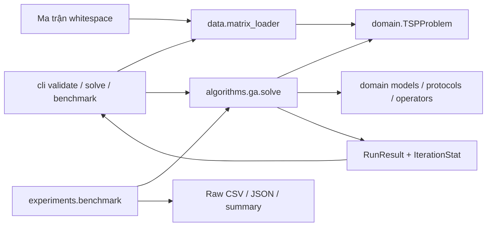

# Kiến trúc và hợp đồng bàn giao GA → EHO

Baseline được đọc toàn bộ: `GUIDELINES.md`, 940 dòng, tiêu đề FINAL.MD, V1.0. Không có `final.md` trong workspace tại thời điểm audit. Không đổi tên/ghi đè tài liệu này. Nội dung triển khai bám các mục 4–7; cây mục 6 là cây đích nên chỉ tạo các module đang dùng. Không có folder hoặc solver EHO giả.

Owner `domain/*`, objective, configs, protocols và benchmark chung: **Trương Thành Đạt**. Thành viên EHO cần đề xuất PR/change request có lý do, tác động và test trước khi thay hợp đồng; không sửa objective để thích nghi với EHO.



`domain` chỉ phụ thuộc stdlib. `data` và `algorithms.ga` phụ thuộc domain. `cli` và `experiments` gọi public API, không đọc population. GUI Tkinter + ttk + Matplotlib là giai đoạn sau; không thay framework. Benchmark không import Matplotlib/Tkinter/NumPy.

## Bất biến dữ liệu

- `TSPProblem`: name, tuple-of-tuples distance_matrix, dimension (property), source, coordinates hoặc None, known_optimum hoặc None, metadata. Sao chép matrix/tọa độ để caller không sửa solver input; metadata là mapping read-only ở mức ngoài, các giá trị metadata nên dùng scalar/immutable. Solver không sửa problem.
- Matrix n≥3, square, finite, nonnegative, diagonal=0; số nguyên đối xứng chính xác, float đối xứng với sai số tuyệt đối ≤1e-9, không dùng relative tolerance. Không có ATSP. Cho phép cạnh bằng 0. Chi phí quá lớn gây overflow bị từ chối rõ ràng.
- `Route = tuple[int, ...]`: city 0 đầu tiên, đủ mỗi city 0..n−1 một lần, không city 0 ở cuối. Objective validate route mỗi lần rồi tính đúng n cạnh. Chỉ CLI đóng vòng hiển thị; JSON giữ route core.
- Loader đọc UTF-8/BOM, whitespace, không header; reject dòng rỗng và dữ liệu sai. Registry có nguồn và name_hint; **known_optimum=None** khi chưa xác minh từng file với nguồn gốc.

## Solver contract v0.1

```python
solve(problem: TSPProblem, config: GAConfig, *,
      progress_callback: ProgressCallback | None = None,
      stop_requested: StopRequested | None = None) -> RunResult
# Solver[GAConfig] và Solver[EHOConfig] trong domain.protocols.
# Solver EHO tương lai nhận EHOConfig, trả cùng RunResult.
```

RNG mỗi run là `random.Random(config.seed)`, được tiêm tới mọi operator; không gọi RNG global. Không I/O/render trong solver. Exception callback và KeyboardInterrupt truyền ra caller, không âm thầm trả success.

`RunConfigBase`: seed (int≥0), max_iterations≥1, max_evaluations hoặc None, time_limit_seconds>0 hoặc None, record_history_every≥1. GA có thêm generations; số vòng hữu hiệu = `min(generations, max_iterations)`; EHO dùng `min(iterations, max_iterations)`. Hai giới hạn đều tường minh trong snapshot; tăng generations trên 250 cần tăng max_iterations nếu muốn vượt 250. Đây là quy tắc phân giải hai field baseline, không tự xóa/đổi tên field.

GAConfig mặc định: population_size=80, generations=250, tournament/3, ox/0.9, inversion/0.15, elite_count=2, random initialization, local search OFF. Chấp nhận population lẻ≥4; elite_count trong 0..population_size−1. Local search fields có trong schema nhưng config bật tính năng chưa làm bị reject.

EHOConfig là **schema**, không có solver: clan_count=4 (≥2), elephants_per_clan=20 (≥3), iterations=250, alpha=0.7, beta=0.3 trong [0,1], separation_count_per_clan=1 (1..clan_size−1), initialization_method=random, preserve_global_best=True; population_size là property tích hai kích thước. Bao gồm mọi field base và validation. Không import `eho` ở bất kỳ đâu.

## Stop/progress/evaluation semantics

1. Khởi tạo và đánh giá toàn bộ population là bước **atomic** để luôn có RunResult hợp lệ/history(0), kể cả stop đã được yêu cầu trước khi gọi. max_evaluations nhỏ hơn population bị reject, không tự tăng budget. Cancel/time được kiểm tra ngay sau bước này và trước mỗi offspring. Vì vậy deadline là cooperative, có thể vượt bởi khởi tạo/một objective/callback, không phải hard real-time.
2. Mỗi candidate thực sự gọi `problem.route_length` tăng evaluations một lần. Elites mang score cũ, không đánh giá lại; offspring dù trùng tour vẫn đánh giá và đếm. Không cache. Full run = P + G×(P−E). Validation/cost check độc lập bên ngoài solver không thuộc evaluations/runtime solver.
3. Global archive cập nhật ngay sau mỗi đánh giá. Chỉ commit population đầy đủ; dừng giữa vòng giữ population đã commit, archive vẫn chứa best của con đã đánh giá. iterations_completed chỉ đếm vòng đầy đủ; metadata.partial_iteration nói rõ vòng dang dở.
4. History/progress ghi iteration 0, mỗi `record_history_every` vòng đầy đủ và snapshot cuối nếu chưa ghi hoặc evaluations đổi. Khi dừng giữa vòng, snapshot cuối có thể trùng iteration nhưng evaluations lớn hơn: best_current/mean_fitness là population đã commit, best_so_far gồm con đã đánh giá. Callback nhận dataclass frozen, không có quần thể. Thứ tự history là thứ tự sự kiện, không phải index theo iteration.
5. stopping_reason: MAX_ITERATIONS, MAX_EVALUATIONS, TIME_LIMIT, CANCELLED. Vòng lặp hết giới hạn iteration thì MAX_ITERATIONS; nếu đồng thời chạm budget tại vòng cuối, iteration cap có ưu tiên vì không còn vòng mới. Callback nên nhanh; runtime bao gồm chi phí callback vì thực thi đồng bộ. Benchmark không dùng callback nên đo solver-only, loại loader/export.
6. RunResult có đầy đủ trường mục 5.2 baseline. result/config_snapshot/metadata là snapshot riêng, không chứa trạng thái solver sống. history/route là tuple; mapping trong result có thể sửa bởi caller sau run. elapsed_seconds không thuộc cam kết tái lập; nghiệm/chi phí/evaluations/history số học có thể tái lập trong cùng version/môi trường khi không dùng time/cancel phụ thuộc thời gian.

## Bàn giao

Ba thành viên EHO có thể import models/protocols/objective/random_permutation mà không import GA; đọc mục 8 baseline để triển khai D-EHO sau lệnh riêng. EHO 1 nhận clans/main loop; EHO 2 nhận discrete operators/correctness; EHO 3 nhận experiment/integration. Không có thay đổi baseline được thực hiện trong lần này. Leader cần review hợp đồng v0.1, xác nhận cách phối hợp hai iteration caps và bước khởi tạo atomic trước khi các PR EHO phụ thuộc nó; nếu muốn đổi semantics, dùng change control cùng tests. Chưa tự gán tên thật cho ba thành viên.
