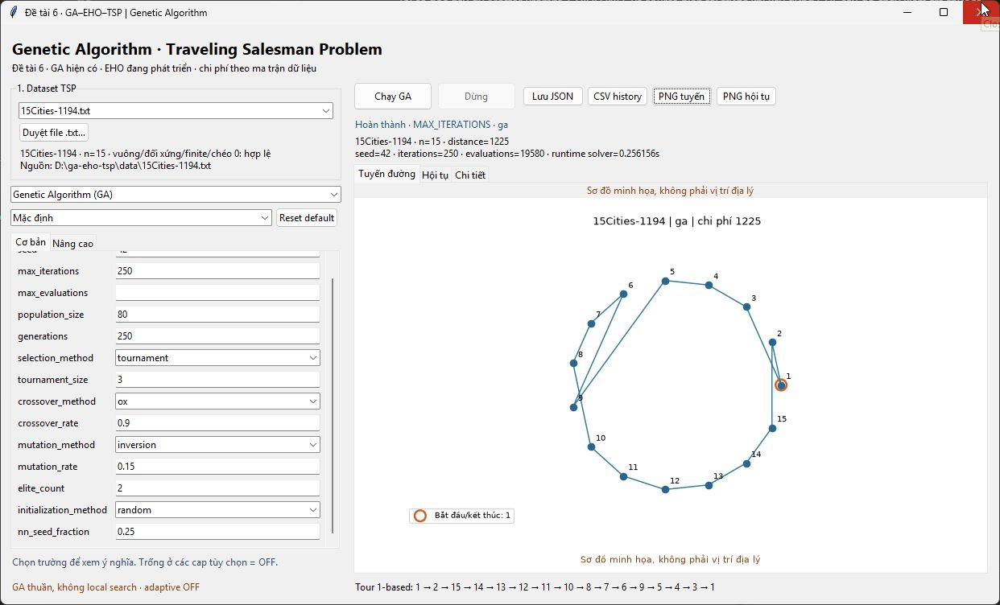
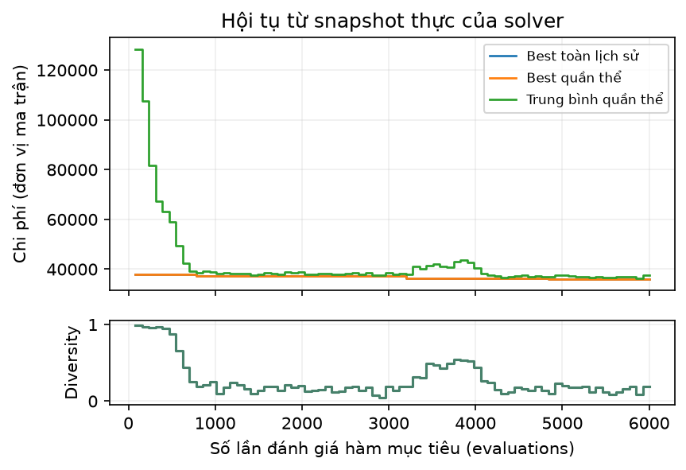

# GA GUI — kết quả nghiệm thu 06/11/2026

Phạm vi: GUI GA P1/P2 hiện tại, không EHO. Môi trường Windows10 build26300, Python3.11.9, Matplotlib3.11.2, package0.2.0, working tree chưa commit. Không dùng166tests lịch sử để nghiệm thu lượt này. Không đo speedup hoặc thay thuật toán.

## Kết quả thực chạy

| Nhóm | Lệnh / cách thực hiện | Kết quả |
|---|---|---|
| Cài đặt | `.venv/Scripts/python.exe -m pip install -r requirements.txt` | Lần sandbox lỗi DNS khi lấy setuptools; retry có mạng cài thành công |
| Môi trường | `python -m pip check` trước/sau | PASS, No broken requirements found |
| CLI trước/sau | validate6city; solve15seed42; solve48seed42PMX/mixed/budget6000 | PASS; distance1225 / 36098, không đổi |
| Dataset | CLI validate đủ7ma trận, loader + SHA256 | 7/7PASS |
| Benchmark trước/sau | `python -m ga_eho_tsp.cli benchmark --config examples/ga_benchmark.json` | Mỗi batch35runs,0failed; summary và raw JSON/CSV có thật ở ignored outputs/ |
| Import/syntax | `python -m compileall -q src` | PASS |
| Headless regression nhỏ, script ngoài repo | 96cases = n3/4/15/48 ×3selection ×2crossover ×4mutation, seed0/P7/rate1; mỗi case lặp2run, kiểm route/cost/accounting/RNG/reproducibility; thêm6case đếm objective bằng instrumentation ở cap9/10/11/80/81/300, adaptive+2-opt | 102casesPASS, không đồng nhất case với số assertions |
| Tk có display thật, driver tự động | Khởi tạo Application, invoke nút Run/Stop/Reset và event loop mainloop thật; dùng solver thật; chỉ thay dialog picker/confirmation bằng đường dẫn/answer trong các ca tự động | 109checksPASS,0callbackerrors; không phải pytest hoặc headless mock Tk |
| Launchers | `python Demo.py`; `python -m ga_eho_tsp.gui` từ cwd ngoài repo | Đều mở Tk window; module launcher kết thúc exit0 khi đóng |
| Desktop kiểm bằng Computer Use | Quan sát cửa sổ thật, Reset, Chạy GA15city; chụp tour/distance/status | PASS phần quan sát trực tiếp; các luồng Stop/close/negative/export được chứng minh bằng driver Tk thật phía trên |
| Notebook Run All | nbclient kernel dùng `.venv`, cwd Experiment/, chỉ lưu bản executed ngoài repo | 3/3PASS,80+30+120=230runs;7.249s/4.532s/9.881s wall time từng notebook |
| Bảo toàn source | SHA25624files thuộc GA/domain/data/Experiment trước/sau | Không đổi byte; không sửa shared API |
| Git/format | `git diff --check`; `git status --short` | PASS whitespace; không commit/push/reset/đổi branch/xóa thay đổi người dùng |

Tk checks bao gồm: đầy đủ schema controls/defaults/presets; EHO disabled; mutation_rate âm, input không phải số, elites≥P; matrix không vuông/âm/NaN/thiếu file; smoke3/4/6/15/26/42/48; seed0/P9lẻ và P8chẵn; OX/PMX,4mutation; mutation0/1; cap=P; TIME_LIMIT/STAGNATION; adaptive+2-opt label; JSON/CSV/2PNG export; CSV đủ history; cwd khác không có data; absence of bundled data; coordinates renderer; heartbeat khi tab hội tụ live và worker đang chạy; chống Run chồng; từ chối đóng; Stop CANCELLED; worker error injection có báo lỗi và chạy lại được; xác nhận đóng trong lúc worker chạy và chờ thread thoát. Failure injection không được tính vào benchmark35runs thật.

Lượt QA đầu dùng driver `root.update()` không hoàn tất case dài, không tính PASS. Lượt mainloop sau phát hiện lỗi Tcl lúc destroy canvas; đã sửa, chạy lại toàn bộ109checks, không bỏ qua lỗi. Xem [gui_guide.md](gui_guide.md) về cách sửa. Khi xem ảnh export phát hiện nhãn Y sát/cắt mép; tăng lề trái và xuất bbox_inches=tight, chạy lại export/109checks và xem ảnh cuối xác nhận đủ nhãn.

Native Save dialog đã mở và quan sát trên desktop; lưu/cancel/overwrite của từng định dạng dùng picker mocked trong driver để ghi vào QA path, không tuyên bố đã click thủ công mọi dialog. Các capture cuối của Computer Use bị gián đoạn bởi tương tác desktop; ảnh bên dưới là capture thực của lần Demo.py đã quan sát, không dựng ảnh từ figure hoặc giả screenshot.

## GUI và CLI cùng toàn bộ config

Driver đặt `ConfigForm` từ GAConfig, invoke Run thật, chờ queue result, lưu qua callback `save()`. CLI chạy subprocess với **mọi field** của config_snapshot, không chỉ seed. So exact best_route, best_distance, seed, iterations_completed, evaluations, reason, config_snapshot và mọi numeric history field trừ elapsed_seconds. Cả hai case PASS. Kiểm cost độc lập từ matrix, permutation và best_so_far monotonic.

| Dataset | Config | Distance | Iterations | Evaluations | GUI solver runtime(s) |
|---|---|---:|---:|---:|---:|
|15city|GAConfig() mặc định,seed42|1225|250|19580|0.240690|
|48city|PMX,mixed,max_evaluations6000,các field còn lại default,seed42|36098|75|6000|0.109174|

Thời gian GUI có overhead callback/GIL contention và biến động theo máy; không dùng hai số này để kết luận nhanh hơn CLI. Snapshot màn hình chụp ở một run khác có runtime0.256156s, cùng kết quả số; không yêu cầu runtime trùng.

Benchmark sau GUI dùng5seed `[11,23,37,53,71]`, P80, random/tournament/OX/inversion/elites2, hai iteration caps2000,6000evaluations/run. Mean distance3/4/6/15/26/42/48city lần lượt **6 /189 /1248 /1200.2 /1056.4 /1166.2 /54194.4**; mean runtime tương ứng **0.047599 /0.048446 /0.052170 /0.068804 /0.085910 /0.121625 /0.109894s**. Đây là batch một máy/mẫu nhỏ, không có claim tối ưu mới hoặc optimum cho bài lớn.

## 10 release gates

| Gate bắt buộc | Trạng thái | Bằng chứng |
|---|---|---|
|1. Demo.py + module launcher|PASS|Cả hai mở cửa sổ thật, dùng cùng main|
|2. Tkinter/ttk/Matplotlib, chọn data/config|PASS|Desktop capture, schema/default/allfield checks|
|3. Run gọi core thật|PASS|Tk runs + exact CLI pairs|
|4. Tour/convergence đúng nhãn|PASS|Đủ cạnh đóng vòng, circular disclaimer, snapshots thật, PNG đã xem|
|5. Responsive/Stop/close worker an toàn|PASS|Live chart heartbeat, CANCELLED, join-by-poll,0Tk callback errors|
|6. Input/dataset lỗi có phục hồi|PASS|Negative cases, lỗi worker injection, run tiếp thành công|
|7. CLI/benchmark/7datasets/3notebooks không hỏng|PASS|35runs0fail,230notebookruns,24hashes không đổi|
|8. Smoke3/15/48 và GUI–CLI|PASS|Cả7sizes và2exact pairs|
|9. README/requirements/guide/handoff|PASS|Tài liệu và lệnh đã cập nhật; không pip-install tkinter|
|10. EHO seam, chưa implement EHO|PASS|ALGORITHMS.eho.solver=None; handoff form/config registration|

**GA GUI READY — SẴN SÀNG BÀN GIAO CHO NHÓM EHO**, trong môi trường Windows đã kiểm chứng và phạm vi GA của Master Prompt. EHO vẫn TODO. Không có blocker bắt buộc còn mở cho GA GUI trong phạm vi trên.

## Ảnh và bằng chứng

Ảnh cửa sổ Tkinter thật sau bấm Run,15city/default/seed42:

PNG hội tụ xuất từ RunResult thật48city/PMX/mixed/6000evaluations:

Script QA, JSON/CSV/PNG, notebook executed copies, checksum manifest và logs nằm ngoài repository tại `C:/Users/THANH DAT/.codex/visualizations/2026/11/05/01a1ac43-7b68-7e63-8442-c7ebf03dd47f/gui-handoff/`. Không tạo tests/ hoặc script tạm trong cây bàn giao. Không xóa/ghi đè notebook gốc; outputs/benchmark do lệnh bắt buộc sinh ra đang được gitignore. Hai PNG được chọn ở docs/screenshots/ là tài liệu nhỏ có chủ đích.

Giới hạn: không có regression suite thường trực trong repo; cần leader/team thống nhất khôi phục khi phát triển EHO. Chưa test Linux/macOS, Full notebook mode, cực lớn ngoài quy mô demo, cài wheel có bundled data hoặc executable. Dataset provenance/licensing và known optimum lớn chưa xác minh đầy đủ. Không sửa frozen GUIDELINES hoặc source người dùng để che các giới hạn này.
